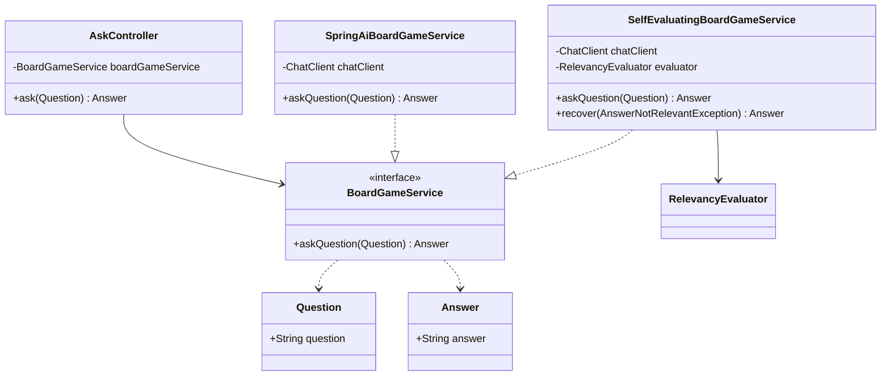

# Spring AI UAS Bayangan

Implementasi praktikum Chapter 1 dan 2 dari *Spring AI in Action*:

- Chapter 1: REST API tanya-jawab dengan Spring AI `ChatClient`.
- Chapter 2: pengujian relevansi dan fakta dengan evaluator Spring AI, serta evaluasi runtime dengan retry dan recovery.

Contoh memakai OpenAI dan model `gpt-4o-mini`. Bagian yang menghubungi layanan AI sungguhan membutuhkan API key dan dapat menimbulkan biaya. Tes WireMock tidak memerlukan API key.

## Prasyarat

- Java 21 atau lebih baru.
- Koneksi internet untuk Gradle Wrapper dan mengunduh dependencies.
- API key OpenAI hanya untuk menjalankan aplikasi terhadap provider sungguhan atau tes `live-ai`.

Jangan masukkan API key ke source code atau Git. Spring AI membaca `SPRING_AI_OPENAI_API_KEY` dari environment.

## Menjalankan tes Chapter 1

```powershell
.\gradlew.bat test
```

Tes WireMock mengembalikan jawaban statis `Paris` dari API tiruan. Karena itu tes tetap dapat dijalankan tanpa koneksi ke OpenAI dan tanpa biaya token.

## Menjalankan aplikasi

Atur key di sesi PowerShell yang sama, lalu jalankan:

```powershell
$env:SPRING_AI_OPENAI_API_KEY = "isi-dengan-api-key-milikmu"
.\gradlew.bat bootRun
```

Kirim pertanyaan di terminal PowerShell lain:

```powershell
Invoke-RestMethod -Method Post `
  -Uri http://localhost:8080/ask `
  -ContentType "application/json" `
  -Body '{"question":"Apa itu Spring AI?"}'
```

Respons berbentuk JSON, misalnya `{"answer":"..."}`. Isi jawaban dapat berubah karena model generatif bersifat probabilistik.

## Chapter 2: evaluasi jawaban

Tes evaluator sengaja dipisahkan dari tes standar karena memanggil model sungguhan:

```powershell
$env:SPRING_AI_OPENAI_API_KEY = "isi-dengan-api-key-milikmu"
.\gradlew.bat liveAiTest
```

Untuk memakai implementasi evaluasi relevansi saat runtime:

```powershell
$env:SPRING_AI_OPENAI_API_KEY = "isi-dengan-api-key-milikmu"
.\gradlew.bat bootRun --args='--spring.profiles.active=self-evaluating'
```

Profil default memakai service Chapter 1. Profil `self-evaluating` mengganti implementasi service dengan versi yang mencoba ulang hingga tiga kali bila jawaban dinilai tidak relevan, lalu mengembalikan pesan recovery.

## Rancangan kelas



## Struktur laporan dan bukti

Gunakan `docs/LAPORAN.md` sebagai kerangka laporan praktikum. Lengkapi hasil pengujian dan bukti berdasarkan eksekusi di komputermu. Rekam demo langsung yang menunjukkan konfigurasi tanpa membocorkan API key, tes WireMock, request/response, live evaluation (jika dijalankan), dan profil runtime evaluator.
